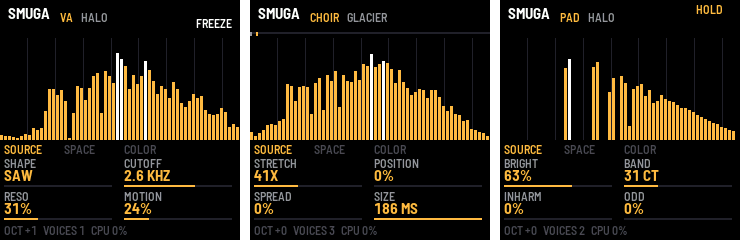

# SMUGA

Spektralny syntezator dla **M-VAVE FM-1**, działający na zasadzie [PaulStretcha](https://hypermammut.sourceforge.net/paulstretch/):
długie okna, zachowane amplitudy widma, **losowe fazy** i nakładanie ramek. Z każdej nuty robi się gęsta,
nieskończona chmura. Custom firmware na [fm1-base](https://github.com/charlesvestal/fm1-base) /
[felucca-bsp](https://github.com/hugelton/felucca-bsp).

> **Status: v0.1, nietestowane na sprzęcie.** Silnik i cała aplikacja przechodzą testy w symulatorze fm1-base
> (te same źródła co firmware), a CI buduje plik `.fwsc` toolchainem JieLi. Na prawdziwym FM-1 jeszcze nie grało:
> pierwsze uruchomienie to test, nie występ. Instalujesz na własne ryzyko.



## Jak to brzmi i jak działa

Trzy rodzaje źródeł widma, jeden silnik:

- **Sample** (16 wbudowanych + USER): sample skanowany bardzo powoli (STRETCH od 1x do ∞), czyli PaulStretch
  wprost. Wbudowane są syntetyzowane przy budowaniu (`app/tools/gen_source.py`), a własne wgrywasz po USB-MIDI.
  Klawisz przesuwa widmo (C4 = oryginalna wysokość), więc jeden sample gra akordami.
- **VA**: oscylator wirtualnie analogowy (saw → square → pulse, wolne LFO z dryfem) grający bez przerwy C4.
  Silnik co ramkę rozmywa jego najnowsze okno i przenosi na wysokość każdego klawisza. Filtr (24 dB/okt, z
  rezonansem) działa na widmie po zsumowaniu głosów, więc ma to samo odcięcie dla każdego klawisza: wysokie nuty
  nie robią się ostrzejsze, a harmoniczne są lekko rozmyte w pasma jak w PADsynth.
- **PAD**: [PADsynth](https://zynaddsubfx.sourceforge.io/doc/PADsynth/PADsynth.htm) tego samego autora: każda
  harmoniczna nuty to gaussowskie pasmo w widmie (szerokość BAND w centach). Nie potrzebuje żadnego materiału
  wejściowego: widmo powstaje od razu w dziedzinie częstotliwości.

| Wbudowane sample | |
|---|---|
| CHOIR, BOWED, FLUTE, BRASS, WHISPR | głosy i instrumenty z formantami: chór na samogłoskach, wiolonczela, flet z oddechem, sekcja dęta, szept |
| PIANO, STRING, KALIMB, GLASS, GAMELN | uderzane i szarpane: fortepian (nieharmoniczność, podwójne struny), Karplus-Strong, kalimba, szkło, gamelan z ombak |
| ORGAN, DRONE, TAPE | organy (rejestry), tanpura z brzękiem jawari, elektryczne pianino z taśmy (wow, flutter, szum) |
| WIND, RAIN, BIRDS | wiatr, deszcz z kroplami, ptaki |

Każdy ma 2,5–4 s, jest syntetyzowany w 44,1 kHz, a trzymany w **11 kHz jako IMA ADPCM + obwiednia SBR**
(~16 KB na 3 s, razem 270 KB flasha). Pasmo powyżej 4,9 kHz silnik odbudowuje przy graniu (SBR, niżej). Jako
WAV-y 44,1 kHz do odsłuchu lub edycji: `python3 app/tools/gen_source.py --out /tmp/s.h --wav-dir starter/` (CI
publikuje je też jako artefakt `starter-samples`).

### SBR: mało w pamięci, pełne pasmo na wyjściu

Sample może leżeć w pamięci w niskiej częstotliwości (11 albo 22 kHz), a silnik odbudowuje brakujące górne
pasmo jak **SBR (Spectral Band Replication)** z HE-AAC. Bierze najwyższą oktawę, którą sample ma, transponuje ją
w górę o oktawy (harmoniczne zostają harmonicznymi) i skaluje do zapisanej obwiedni: 8 pasm co 50 ms, ~170 bajtów
na sekundę. W zwykłym kodeku słabością SBR są fazy i transjenty, ale PaulStretch i tak losuje fazy, więc tutaj
ta metoda nie ma praktycznie wad. Test (`tests/dsp_test.c`): STRING trzymany w 11 kHz odbiega od pełnopasmowego
oryginału w paśmie 5–16 kHz średnio o 2,0 dB z SBR, a bez SBR o 14,4 dB.

## Obsługa

| Element | Funkcja |
|---|---|
| Klawisze | nuty z velocity, **OCT− / OCT+** oktawa |
| **K1–K4** | cztery parametry bieżącej strony |
| **SEL** / **SELECT** | następna strona: SOURCE → SPACE → COLOR (**EDIT**, **ENV**, **FX** skaczą wprost) |
| **ALGORITHM** | źródło: PAD / VA / 16 wbudowanych sampli / USER (USER tylko po wgraniu sampla) |
| **PRESET** | presety fabryczne |
| **PLAY** | HOLD: nuty zostają po puszczeniu klawiszy; nowy akord zastępuje poprzedni |
| **REC** | FREEZE: widmo zamrożone (sample: skan staje; VA: chwila zatrzymana) |
| **HOME** | wszystkie nuty off (i HOLD off) |
| **SAVE** | zapis ustawień |
| MASTER | głośność |

| Strona | K1 | K2 | K3 | K4 |
|---|---|---|---|---|
| SOURCE (sample) | STRETCH 1x…10000x, ∞ | POSITION | SPREAD (rozmycie widma) | SIZE 23…186 ms |
| SOURCE (PAD) | BRIGHT | BAND (centy) | INHARM | ODD (bez parzystych) |
| SOURCE (VA) | SHAPE saw → square → pulse | CUTOFF 60 Hz…18 kHz (stały dla wszystkich klawiszy) | RESO | MOTION (wolne LFO i dryf odcięcia) |
| SPACE | ATTACK | RELEASE | WIDTH (stereo) | LEVEL |
| COLOR | TILT ±6 dB/okt | SUB (oktawa niżej) | SHIMMER (oktawa wyżej) | SIZE |

MIDI in (USB, TRS): nuty na dowolnym kanale, CC64 sustain, **CC1 POSITION** (przewijanie sampla kółkiem
modulacji), CC71 SPREAD, CC74 TILT, CC120/123 wszystko off. Nuty z klawiatury FM-1 wychodzą po USB.

Presety: GLACIER, FOG, HALO, ORGAN DUST, BELL CLOUD, ANALOG MIST, RESO SWEEP, GLASS RAIN, HARP DREAM,
WIND TUNNEL, FELT DREAM, CELLO SEA, TANPURA, RAIN ROOM, DAWN, TAPE MEMORY, GRAIN, FROZEN, DEEP.

Na ekranie widać widmo ostatniej ramki (40 Hz…16 kHz, linie co oktawę), pozycję skanu sampla na górze, a w stopce
oktawę, liczbę głosów i **CPU %**. Proszę, zanotuj CPU % przy pierwszym uruchomieniu (najlepiej preset FOG,
8 nut, SIZE 186 ms).

## Własny sample

```sh
pip install numpy mido python-rtmidi
python3 tools/smuga_load.py moj_dzwiek.wav                 # mono, 22,05 kHz, ADPCM + SBR: do 24 s
python3 tools/smuga_load.py moj_dzwiek.wav --rate 11025    # 4,9 kHz w pamięci, reszta z SBR: do 48 s
python3 tools/smuga_load.py moj_dzwiek.wav --pcm16         # 16 bit bez szumu ADPCM: do 6,3 s
python3 tools/smuga_load.py moj_dzwiek.wav --rate 44100    # pełne pasmo, bez SBR: do 12 s (3,1 s z --pcm16)
python3 tools/smuga_load.py dlugi.wav --start 12 --secs 5  # fragment
python3 tools/smuga_load.py moj_dzwiek.wav --syx out.syx   # plik .syx dla SysEx Librarian / MIDI-OX
```

Sample trafia do flasha (przetrwa wyłączenie) i od razu staje się źródłem USER. ADPCM ma odstęp sygnału od szumu
ok. 27–36 dB: po rozmyciu fazy szum kwantyzacji zamienia się w cichy „oddech” pod chmurą, co zwykle nie
przeszkadza. Do czystych, cichych materiałów użyj `--pcm16`. Przerwane wgrywanie niczego nie
psuje: nagłówek jest kasowany na początku i zapisywany dopiero po sprawdzeniu CRC.

## Budowanie

```sh
git clone --recursive https://github.com/twaroshinto/fm1-smuga && cd fm1-smuga
sh tests/run.sh          # testy silnika + cała aplikacja w symulatorze (cc, python3, Pillow, numpy)
./build.sh --host        # sam symulator: app/build/host/smuga_host SKRYPT KATALOG
./build.sh               # firmware: app/build/smuga.fwsc
```

Firmware wymaga toolchaina JieLi (Linux x86-64) i trzech plików z SDK AC79:

```sh
sh base/tools/get_toolchain.sh ~/.jieli
sh base/bsp/tools/get_sdk.sh ~/.jieli/ac79-sdk
JIELI_TOOLCHAIN=~/.jieli/toolchain AC79_SDK=~/.jieli/ac79-sdk ./build.sh
```

Najprościej: **GitHub Actions** (`.github/workflows/build.yml`) robi to samo i wystawia `smuga.fwsc` jako artefakt
każdego pusha; tag `vX.Y` tworzy release.

## Instalacja i powrót

```sh
python3 base/tools/fm1_install.py app/build/smuga.fwsc     # przez USB-MIDI (mido + python-rtmidi)
```

Powrót do oficjalnego firmware: updater M-VAVE (albo „Return to official” w instalatorze Felucci). Jeśli coś
pójdzie źle, przytrzymanie **OCT− i OCT+ przez 5 s** wchodzi w tryb aktualizacji, a
`base/bsp/tools/fm1_rescue.sh` (macOS) przywraca oryginał na FM-1, które nie startuje.

## Struktura

| Ścieżka | Co |
|---|---|
| `app/dsp/smuga.c`, `smuga.h` | silnik: przenośne C99, float, bez alokacji i bez libc; dekoder ADPCM |
| `app/dsp/va.c`, `va.h` | źródło VA: oscylator polyBLEP, filtr SVF, MOTION |
| `app/app.c`, `app/app.h` | aplikacja FM-1: panel, ekran, MIDI, presety, wgrywanie sampli (SysEx) |
| `app/fm1.toml` | ustawienia builda fm1-base |
| `app/tools/gen_source.py` | generator wbudowanych sampli (przy budowaniu, bez nagrań i licencji) |
| `app/tools/smg_adpcm.py` | koder IMA ADPCM w formacie silnika (generator i `smuga_load.py`) |
| `app/tools/smg_sbr.py` | resampling i obwiednia SBR (numpy) |
| `app/tests/*.txt` | scenariusze symulatora: klawisze, strony, HOLD, FREEZE, MIDI, zapis, wgrywanie sampla |
| `tests/dsp_test.c` | testy silnika: wysokość dźwięku, poziomy, cisza po release, brak spóźnionych ramek, budżet pracy |
| `tools/smuga_load.py` | wgrywanie WAV-ów po USB-MIDI |
| `base/` | fm1-base (submoduł) |

## Licencja i podziękowania

MPL-2.0, jak fm1-base. Pomysł losowych faz na długich oknach i profil PADsynth pochodzą od Nasci Octaviana Paula
(PaulStretch, PADsynth). **Kod SMUGI jest napisany od zera i nie zawiera kodu PaulStretcha** (który jest na GPL).
Platforma: fm1-base (Charles Vestal) i felucca-bsp (Leo Kuroshita, Hügelton Instruments). Projekt nieoficjalny,
niezwiązany z M-VAVE ani JieLi.
