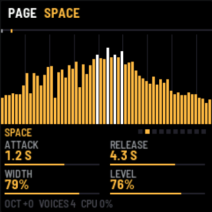
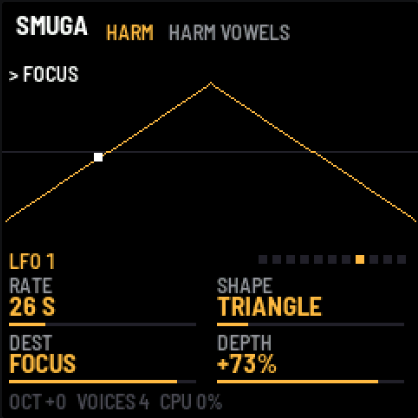

# SMUGA: instrukcja obsługi

SMUGA to firmware dla M-VAVE FM-1, które zamienia każdy dźwięk w gęstą, nieskończoną chmurę. Działa jak
PaulStretch: bierze długi fragment dźwięku, zachowuje jego barwę (widmo), a fazy zastępuje losowymi. Dźwięk
traci ataki i rytm, a zostaje sam kolor. Klawiatura przesuwa ten kolor na wysokość nuty, więc grasz nim akordy.

Wszystkie zrzuty pochodzą z emulatora w przeglądarce, w którym działa ten sam kod co na urządzeniu.

> Wersja v0.4, jeszcze nietestowana na prawdziwym FM-1.

## Panel


| Nr | Element | Co robi |
|---|---|---|
| 1 | **MASTER** | głośność |
| 2 | **SELECT** | przewija strony parametrów (jak SEL) |
| 3 | **PRESETS** | wybiera preset (24 fabryczne) |
| 4 | **ALGORITHM** | wybiera źródło dźwięku (PAD, VA, HARM, 16 sampli, USER) |
| 5 | ekran | źródło i preset, podgląd (widmo, harmoniczne, LFO), cztery parametry bieżącej strony |
| 6 | **KNOB 1–4** | cztery parametry bieżącej strony, w kolejności jak na ekranie: lewy górny, prawy górny, lewy dolny, prawy dolny |
| 7 | **FX** | strona COLOR |
| 8 | **SEL** | następna strona |
| 9 | **ENV** | strona SPACE, a przy źródle HARM kolejne naciśnięcia przechodzą przez ENV A, B, C, D |
| 10 | **LFO** | strony modulacji: LFO 1 → LFO 2 → MOD ENV |
| 11 | **EDIT** | strona SOURCE, a przy HARM drugie naciśnięcie daje TONE |
| 12 | **HOME** | wycisza wszystkie nuty i wyłącza HOLD |
| 13 | **SAVE** | zapisuje ustawienia, przycisk świeci, gdy jest coś niezapisanego |
| 14 | **PLAY** | HOLD: nuty grają dalej po puszczeniu klawiszy, a nowy akord zastępuje poprzedni |
| 15 | **REC** | FREEZE: zamraża widmo sampla albo VA w bieżącej chwili (przy PAD i HARM nie działa) |
| 16 | **OCT− / OCT+** | oktawa klawiatury, ±2 |
| 17 | klawisze | 27 klawiszy z dynamiką, od F3 (przy oktawie 0) |

GLO, ARP i SEQ są na razie wolne.

Przycisk grupy, w której jesteś, świeci: EDIT dla SOURCE/TONE, ENV dla SPACE i ENV A–D, LFO dla modulacji,
FX dla COLOR.

## Ekran


- **Góra:** nazwa, źródło (pomarańczowe) i preset (szary). Po prawej HOLD i FREEZE, gdy są włączone. Po każdym
  ruchu gałki przez chwilę widać tu jej nazwę i wartość.

- **Środek:** zależy od strony. Zwykle to widmo ostatniej ramki, od 40 Hz do 16 kHz, z liniami co oktawę. Przy
  samplu nad widmem jest pasek skanu: szary znacznik pokazuje POSITION, jasny miejsce, które gra teraz. Przy HARM
  widać harmoniczne, a na stronach modulacji przebieg LFO albo obwiedni.

- **Nazwa strony** z kropkami po prawej: jedna kropka na każdą stronę, którą ma bieżące źródło, a jasna to ta,
  na której jesteś.

- **Cztery parametry** z wartością i paskiem. **Biały znacznik na pasku** oznacza, że parametr jest modulowany i
  pokazuje, gdzie jest w tej chwili. Sama gałka trzyma swoją wartość.

- **Stopka:** oktawa, liczba brzmiących głosów (do 8) i obciążenie procesora.

## Źródła (ALGORITHM)

| Źródło | Co to jest |
|---|---|
| **PAD** | gotowe chmury harmoniczne (PADsynth): każda harmoniczna to rozmyte pasmo |
| **VA** | oscylator wirtualnie analogowy z filtrem, rozmywany na żywo |
| **HARM** | generator harmonicznych: liczba, nachylenie, uwypuklenie, 4 obwiednie na wybrane harmoniczne |
| **CHOIR … TAPE** | 16 wbudowanych sampli: chór, szkło, struny, wiatr, fortepian, wiolonczela, flet, organy, kalimba, sekcja dęta, tanpura, deszcz, ptaki, szept, gamelan, pianino z taśmy |
| **USER** | sample wgrany z komputera (pojawia się dopiero po wgraniu) |

Przy samplach klawisz C4 gra oryginalną wysokość, a inne klawisze przesuwają całe widmo.

## Strony i gałki

Każda strona to cztery parametry pod KNOB 1–4. Strony SOURCE i TONE zależą od źródła. TONE i ENV A–D są tylko
przy HARM.

### SOURCE: sample (CHOIR … TAPE, USER)


| Gałka | Parametr | Zakres | Co robi |
|---|---|---|---|
| 1 | **STRETCH** | 1x … 8000x, INF | ile razy wolniej skanowany jest sample; INF zatrzymuje skan w miejscu |
| 2 | **POSITION** | 0–100 % | skąd zaczyna się skan (i dokąd wraca po końcu); przy STRETCH INF to „przewijanie” |
| 3 | **SPREAD** | 0–100 % | rozmycie widma: tony rozlewają się w pasma szumu |
| 4 | **SIZE** | 23, 46, 93, 186 ms | długość okna: krótkie jest ziarniste i szybciej reaguje, długie jest gładkie |

### SOURCE: PAD


| Gałka | Parametr | Zakres | Co robi |
|---|---|---|---|
| 1 | **BRIGHT** | 0–100 % | jasność: jak wolno słabną wyższe harmoniczne |
| 2 | **BAND** | 1–300 centów | szerokość każdej harmonicznej: wąsko to organy, szeroko to chór |
| 3 | **INHARM** | 0–100 % | rozjeżdżanie harmonicznych w górę, jak w dzwonie lub sztywnej strunie |
| 4 | **ODD** | 0–100 % | wycina parzyste harmoniczne (brzmienie „puste”, klarnetowe) |

### SOURCE: VA


| Gałka | Parametr | Zakres | Co robi |
|---|---|---|---|
| 1 | **SHAPE** | SAW → SQUARE → PULSE | kształt fali: piła, kwadrat, coraz węższy prostokąt |
| 2 | **CUTOFF** | 60 Hz – 18 kHz | odcięcie filtra (24 dB/okt), takie samo dla każdego klawisza |
| 3 | **RESO** | 0–100 % | rezonans filtra: wyraźny szczyt przy odcięciu |
| 4 | **MOTION** | 0–100 % | wolne LFO z dryfem na odcięciu, chmura „oddycha” |

### SOURCE i TONE: HARM

HARM buduje dźwięk z harmonicznych, a na ekranie widzisz ich poziomy jako słupki H1–H32 (skala 48 dB).


| Gałka | Parametr | Zakres | Co robi |
|---|---|---|---|
| 1 | **HARMONICS** | 1–64 | ile harmonicznych |
| 2 | **SLOPE** | 0 … −18 dB/okt | jak szybko słabną wyższe: 0 to wszystkie równe (jasno), −18 to prawie sama podstawa |
| 3 | **EVEN/ODD** | EVEN 100 % … BOTH … ODD 100 % | w stronę ODD wycisza parzyste, w stronę EVEN nieparzyste (podstawa zostaje) |
| 4 | **H BAND** | 1–150 centów | szerokość każdej harmonicznej: wąsko to czysty ton, szeroko to chór |

Drugie naciśnięcie EDIT otwiera **TONE**: uwypuklenie lub wycięcie wokół wybranej harmonicznej i reakcję na
dynamikę.


| Gałka | Parametr | Zakres | Co robi |
|---|---|---|---|
| 1 | **FOCUS** | H1–H32 | harmoniczna, wokół której działa BOOST |
| 2 | **BOOST** | −24 … +24 dB | uwypuklenie (+) albo wycięcie (−) wokół FOCUS, jak formant |
| 3 | **FOCUS W** | 0,4–6 harmonicznych | szerokość uwypuklenia: wąsko to jedna harmoniczna, szeroko to grupa |
| 4 | **VEL>TONE** | 0–100 % | cichsze uderzenie daje ciemniejszą barwę: tyle, ile ustawisz |

### ENV A–D: obwiednie harmonicznych (HARM)

Cztery obwiednie, z których każda steruje wybranymi harmonicznymi. Biegną od początku każdej nuty: narastają
przez ATTACK do pełnej głośności, opadają przez DECAY do poziomu SUSTAIN i tam zostają. Harmoniczne, których
żadna obwiednia nie dotyczy, grają cały czas. Gdy kilka obwiedni trafia w tę samą harmoniczną, ich działanie się
mnoży.

Na stronie obwiedni harmoniczne, którymi steruje, świecą na biało, a w prawym górnym rogu widać jej kształt.
Harmoniczne innych obwiedni są przygaszone na pomarańczowo.

 

| Gałka | Parametr | Zakres | Co robi |
|---|---|---|---|
| 1 | **TARGET** | OFF, H1–H32, ODD, EVEN, LOW 1-4, MID 5-12, HIGH 13+, ALL | którymi harmonicznymi steruje |
| 2 | **ATTACK** | 10 ms – 20 s | czas narastania |
| 3 | **DECAY** | 50 ms – 30 s | czas opadania do SUSTAIN |
| 4 | **SUSTAIN** | 0–100 % | poziom, na którym zostaje |

Przykłady:

- **ENV A = H3, ATTACK 0,2 s, DECAY 0,6 s, SUSTAIN 0 %** (lewy zrzut): trzecia harmoniczna błyska na początku nuty i znika.
- **ENV B = HIGH 13+, ATTACK 4 s, SUSTAIN 100 %** (prawy zrzut): wysokie harmoniczne wchodzą powoli i barwa się otwiera.
- **TARGET = H1, SUSTAIN 30 %**: podstawa cichnie po ataku, zostaje „powietrze”.

Wyciszenie całej nuty po puszczeniu klawisza ustawiasz osobno: RELEASE na stronie SPACE.

### SPACE (ENV)



| Gałka | Parametr | Zakres | Co robi |
|---|---|---|---|
| 1 | **ATTACK** | 10 ms – 20 s | narastanie nuty |
| 2 | **RELEASE** | 50 ms – 30 s | wybrzmiewanie po puszczeniu klawisza |
| 3 | **WIDTH** | 0–100 % | szerokość stereo: 0 to mono, 100 to dwa niezależne kanały |
| 4 | **LEVEL** | 0–100 % | głośność silnika (zapas przed miękkim ogranicznikiem) |

### LFO 1, LFO 2 i MOD ENV: modulacja (LFO)

Trzy modulatory, a każdy może poruszać jednym parametrem: dwa LFO i obwiednia modulacyjna. Modulacja dodaje się
do ustawienia gałki, więc gałka wyznacza środek, a modulator porusza wokół niego. DEPTH ±100 % oznacza ruch o
cały zakres parametru. Ujemna głębokość odwraca kierunek.

 

**LFO 1 i LFO 2:**

| Gałka | Parametr | Zakres | Co robi |
|---|---|---|---|
| 1 | **RATE** | 0,01–10 Hz | tempo; poniżej 1 Hz ekran pokazuje okres w sekundach (np. 26 S) |
| 2 | **SHAPE** | SINE, TRIANGLE, SAW UP, SAW DOWN, SQUARE, RANDOM, DRIFT | kształt; RANDOM skacze co cykl, DRIFT płynie do losowych punktów |
| 3 | **DEST** | OFF i lista celów niżej | który parametr porusza |
| 4 | **DEPTH** | −100 … +100 % | jak mocno i w którą stronę |

**MOD ENV** startuje przy każdej nowej nucie (z klawiatury i z MIDI): narasta przez ATTACK, potem opada do zera
przez DECAY. Gałki: **ATTACK**, **DECAY**, **DEST**, **DEPTH**.

Na ekranie widać przebieg z kropką w bieżącym miejscu (LFO) albo kształt obwiedni z kreską na bieżącym poziomie
(MOD ENV), a nad nim cel. Na stronie parametru, który jest modulowany, biały znacznik na pasku pokazuje jego
bieżącą wartość:

 

**Cele (DEST):** STRETCH, POSITION, SPREAD, TILT, SUB, SHIMMER, WIDTH, LEVEL, BRIGHT, BAND, INHARM, ODD, SHAPE,
CUTOFF, RESO, SLOPE, EVEN/ODD, FOCUS, BOOST, H BAND. Cel działa tylko wtedy, gdy dotyczy bieżącego źródła: na
przykład CUTOFF porusza filtrem VA, a FOCUS działa przy HARM.

Silnik bierze nowe wartości raz na ramkę, czyli co 11–93 ms zależnie od SIZE. Bardzo szybkie LFO przy dużym SIZE
będzie więc schodkowe. Ta estetyka lubi tempa poniżej 1 Hz.

Kilka pomysłów:

- **LFO na POSITION** (SINE, kilka sekund) przy STRETCH INF przewija sample tam i z powrotem.
- **LFO na FOCUS** (TRIANGLE, wolno) przy BOOST +12 dB daje „samogłoski” przesuwające się po harmonicznych (preset HARM VOWELS).
- **DRIFT na POSITION** sprawia, że skan błądzi po samplu w nieprzewidywalny sposób (preset DRIFT FOG).
- **SINE na TILT**, bardzo wolno, daje barwę, która sama się otwiera i przymyka.
- **MOD ENV na SPREAD** z ujemnym DEPTH sprawia, że każda nowa nuta zaczyna się czysto i rozmywa.

### COLOR (FX)


| Gałka | Parametr | Zakres | Co robi |
|---|---|---|---|
| 1 | **TILT** | −6 … +6 dB/okt | przechylenie barwy: ciemniej lub jaśniej, z osią w 500 Hz |
| 2 | **SUB** | 0–100 % | dokłada to samo widmo oktawę niżej |
| 3 | **SHIMMER** | 0–100 % | dokłada to samo widmo oktawę wyżej |
| 4 | **SIZE** | 23–186 ms | to samo co SIZE na stronie sampla, dostępne przy każdym źródle |

## Presety

| Preset | Źródło | Charakter |
|---|---|---|
| GLACIER | CHOIR | chór rozciągnięty ~40x, punkt startowy |
| FOG | CHOIR | wolniej, rozmyte, ciemniej, z oktawą niżej |
| HALO | PAD | jasny pad z oktawą wyżej |
| ORGAN DUST | PAD | wąskie pasma, bez parzystych: organy |
| BELL CLOUD | PAD | nieharmoniczne, dzwonowe |
| ANALOG MIST | VA | piła, ciepły filtr, MOTION |
| RESO SWEEP | VA | kwadrat, rezonans, wyraźny ruch filtra |
| HARM BLOOM | HARM | wysokie harmoniczne wchodzą powoli; LFO 1 na TILT |
| HARM BELL | HARM | błysk wysokich harmonicznych i H3 na ataku, uwypuklona H5 |
| HARM VOWELS | HARM | LFO przesuwa FOCUS i BOOST: wędrujące samogłoski |
| HARM HOLLOW | HARM | same nieparzyste (klarnetowo), wysokie harmoniczne wchodzą powoli przez ENV A |
| DRIFT FOG | CHOIR | DRIFT błądzi skanem po samplu (POSITION), drugie LFO kołysze barwą (TILT) |
| GLASS RAIN | GLASS | szkło, z oktawą wyżej |
| HARP DREAM | STRING | struny, szeroko |
| WIND TUNNEL | WIND | wiatr, rozmyty, bardzo szeroki |
| FELT DREAM | PIANO | ciemny fortepian |
| CELLO SEA | BOWED | wiolonczela, długie narastanie |
| TANPURA | DRONE | brzęczący bordun, przyciemniony |
| RAIN ROOM | RAIN | deszcz w pokoju |
| DAWN | BIRDS | ptaki rozmyte w świt |
| TAPE MEMORY | TAPE | pianino z taśmy |
| GRAIN | CHOIR | najkrótsze okno, ziarniste, szybkie |
| FROZEN | CHOIR | STRETCH INF, mocno rozmyte, zamrożona chwila |
| DEEP | PAD | ciemny, z mocną oktawą niżej |

Wybranie presetu zmienia źródło i wszystkie gałki. SAVE zapamiętuje bieżący stan, także po zmianach gałek, ale
jest tylko jedno miejsce zapisu.

## Grane

- **HOLD (PLAY):** zagraj akord, puść, a on trwa. Następny akord zastępuje poprzedni. Ponowne PLAY wyłącza HOLD
  i puszcza nuty.

- **FREEZE (REC):** zatrzymuje widmo sampla albo VA w bieżącej chwili. Nuty, obwiednie i SPACE grają dalej, a
  skan rusza z miejsca po wyłączeniu FREEZE. Przy PAD i HARM widmo i tak powstaje z gałek, więc FREEZE nic nie zmienia.

- **Opóźnienie:** nuta zaczyna brzmieć w następnej ramce, po ~100–140 ms przy SIZE 186 ms i ~20 ms przy 23 ms.
  To część charakteru, nie błąd.

- **Polifonia:** 8 głosów. Dziewiąta nuta zabiera najcichszy głos.

## MIDI

Przez USB i gniazdo TRS:

| Wiadomość | Działanie |
|---|---|
| nuty, dowolny kanał | grają (z dynamiką) |
| CC64 | sustain |
| CC1 (kółko modulacji) | POSITION |
| CC71 | SPREAD |
| CC74 | TILT |
| CC120, CC123 | wszystko off |

Nuty z klawiatury FM-1 wychodzą po USB.

## Własny sample

```sh
pip install numpy mido python-rtmidi
python3 tools/smuga_load.py moj.wav                 # do 24 s, 22 kHz + odbudowa górnego pasma (SBR)
python3 tools/smuga_load.py moj.wav --rate 11025    # do 48 s
python3 tools/smuga_load.py moj.wav --pcm16         # bez szumu kompresji, do 6 s
```

Po wgraniu źródło przełącza się na USER, a sample zostaje w pamięci po wyłączeniu. Wgrywanie nie działa w
emulatorze.

## Emulator w przeglądarce

Ten sam firmware działa w przeglądarce: zbuduj `./build.sh --web` albo pobierz artefakt `smuga-emulator` z CI.
Kliknij **Switch on**. Gałki kręcisz przeciągnięciem w górę/dół, kółkiem albo strzałkami. Akordy myszką robisz
Shift-klikiem (klawisz zostaje wciśnięty).

| Klawisz komputera | FM-1 |
|---|---|
| `Q`–`I`, `A`–`K` | białe klawisze |
| `1`–`0`, `-` | czarne klawisze |
| `Z` / `X` | OCT− / OCT+ |
| `P` | PLAY (HOLD) |
| `O` | REC (FREEZE) |
| `Esc` | HOME |
| `↑` / `↓` na panelu | SELECT (strony) |


