# AEther: instrukcja obsługi

AEther to firmware dla M-VAVE FM-1, które zamienia każdy dźwięk w gęstą, nieskończoną chmurę. Działa jak
PaulStretch: bierze długi fragment dźwięku, zachowuje jego barwę (widmo), a fazy zastępuje losowymi. Dźwięk
traci ataki i rytm, a zostaje sam kolor. Klawiatura przesuwa ten kolor na wysokość nuty, więc grasz nim akordy.

Wszystkie zrzuty pochodzą z emulatora w przeglądarce, w którym działa ten sam kod co na urządzeniu.

> **Kod wygenerowany przez AI, bez gwarancji. Używasz go na własną odpowiedzialność** (plik NOTICE w repozytorium).
> Uważaj na głośność: dźwięk bywa głośny i ostry.
>
> Wersja v0.5, pierwsze uruchomienia na prawdziwym FM-1. English version: [the manual in English](MANUAL.md).

## Instalacja

1. Otwórz [instalator w przeglądarce](https://twaroshinto.github.io/AEther/install/) w Chrome albo Edge, podłącz
   FM-1 kablem USB (bezpośrednio do komputera) i naciśnij **Install**. Nie odłączaj kabla w trakcie zapisu.
2. **Po zakończeniu zrestartuj FM-1: wyłącz go i włącz ponownie.** FM-1 sam uruchamia AEthera po instalacji, ale
   bez pełnego restartu dźwięk może się przerywać; po restarcie gra czysto.

Aby wrócić do firmware'u M-VAVE, użyj „Back to the stock firmware” w instalatorze albo M-UPGRADE od M-VAVE.

## Panel

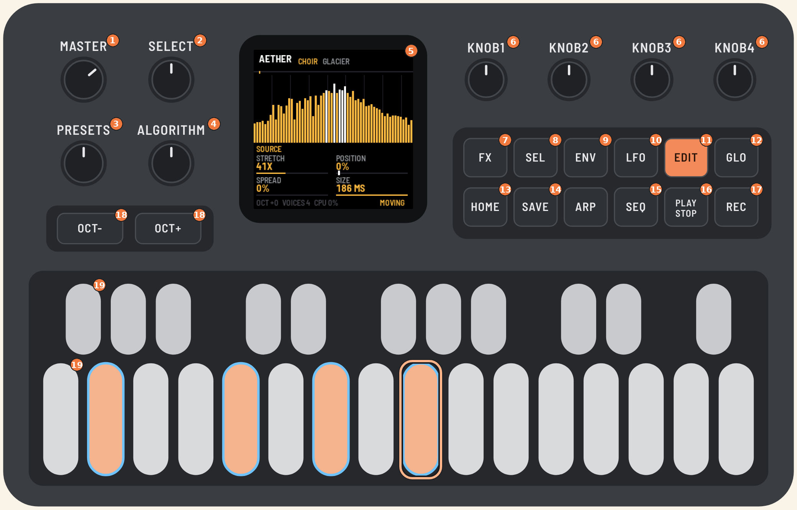

| Nr | Element | Co robi |
|---|---|---|
| 1 | **MASTER** | głośność |
| 2 | **SELECT** | wybiera, który sample albo który generator LIVE (w obrębie rodzaju wybranego gałką ALGORITHM) |
| 3 | **PRESETS** | wybiera preset (31 fabrycznych) |
| 4 | **ALGORITHM** | wybiera rodzaj źródła: SAMPLE, LIVE, PAD, HARM, VA |
| 5 | ekran | źródło i preset, podgląd (widmo, harmoniczne, LFO, matryca), cztery parametry bieżącej strony |
| 6 | **KNOB 1–4** | cztery parametry bieżącej strony, w kolejności jak na ekranie: lewy górny, prawy górny, lewy dolny, prawy dolny |
| 7 | **FX** | barwa: COLOR → EQ 1 → EQ 2 → EQ 3 (korektor parametryczny) |
| 8 | **SEL** | następna strona (wszystkie po kolei) |
| 9 | **ENV** | obwiednie: AMP → MOD ENV 1 → MOD ENV 2; przytrzymany + gałka: modulacja obwiednią |
| 10 | **LFO** | LFO 1 → LFO 2 → LFO 3 → MATRIX; przytrzymany + gałka: modulacja LFO |
| 11 | **EDIT** | źródło: SOURCE, a przy HARM dalej TONE i HARM ENV A–D |
| 12 | **GLO** | SETUP: ustawienia globalne (drugi rdzeń, bezpiecznik przeciążenia) |
| 13 | **HOME** | wraca na stronę główną (SOURCE); na niej wycisza wszystkie nuty i wyłącza HOLD; przytrzymany pokazuje mapę przycisków |
| 14 | **SAVE** | zapisuje ustawienia, przycisk świeci, gdy jest coś niezapisanego |
| 15 | **SEQ** | EVOLVE: jak dźwięk zmienia się w czasie (głębia i tempo ruchu, dryf, warianty ruchu) |
| 16 | **PLAY** | HOLD: nuty grają dalej po puszczeniu klawiszy, a nowy akord zastępuje poprzedni |
| 17 | **REC** | FREEZE: zamraża widmo sampla albo VA w bieżącej chwili (przy PAD i HARM nie działa) |
| 18 | **OCT− / OCT+** | oktawa klawiatury, ±2 |
| 19 | klawisze | 27 klawiszy z dynamiką i naciskiem, od F3 (przy oktawie 0) |

ARP jest na razie wolny, więc nie świeci.

## Jak się poruszać

Strony są pogrupowane pod pięcioma przyciskami. Każdy przycisk ma swoje strony:

| Przycisk | Strony | Co tam jest |
|---|---|---|
| **EDIT** | SOURCE (+ TONE, HARM ENV A–D przy HARM) | dźwięk źródła |
| **ENV** | AMP → MOD ENV 1 → MOD ENV 2 | obwiednie: głośności i dwie modulacyjne |
| **LFO** | LFO 1 → LFO 2 → LFO 3 → MATRIX | LFO i matryca, która je rozprowadza |
| **SEQ** | EVOLVE | jak dźwięk zmienia się w czasie |
| **FX** | COLOR → EQ 1 → EQ 2 → EQ 3 | barwa: TILT, SUB, SHIMMER, SIZE, potem trzy pasma korektora |
| **GLO** | SETUP | ustawienia globalne |

Zasady są trzy:

1. **Przycisk innej grupy** wraca na stronę, na której byłeś w tej grupie ostatnio. Jeśli edytowałeś LFO 2, poszedłeś
   do AMP i wcisnąłeś LFO, wracasz do LFO 2.
2. **Ten sam przycisk ponownie** przechodzi do następnej strony grupy (po ostatniej wraca do pierwszej). Kropki przy
   nazwie strony pokazują, ile stron ma grupa i na której jesteś.
3. **HOME** zawsze wraca na stronę główną (SOURCE). Wciśnięty na stronie głównej wycisza wszystkie nuty.

**SEL** przechodzi przez wszystkie strony po kolei, grupa po grupie.

**Mapa przycisków.** Przytrzymaj **HOME**, a na ekranie pojawi się, co teraz robi każdy przycisk. Jego obramowanie
pokazuje grupę, w której jesteś. Puść HOME, żeby wrócić.

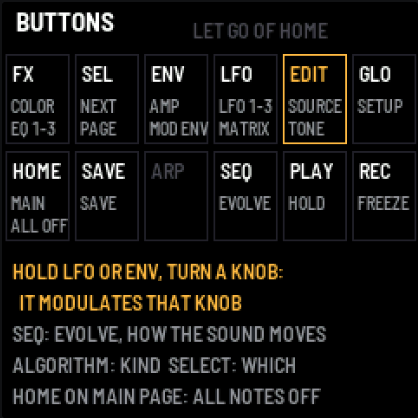

**Światła przycisków.** Jasno świeci przycisk grupy, w której jesteś, a także PLAY przy włączonym HOLD, REC przy
FREEZE i SAVE, gdy są niezapisane zmiany. Przyciski, które coś robią, świecą słabo, a nieużywany ARP jest ciemny.

**Szybka modulacja.** Przytrzymaj **LFO** (albo **ENV**) i kręć gałką na dowolnej stronie. Ostatnio oglądane LFO
(albo MOD ENV) zacznie poruszać parametrem pod tą gałką, z siłą, którą wykręcisz. Szczegóły w części o modulacji.

**Presety a zmiany.** Gdy zmienisz coś po wybraniu presetu, przy jego nazwie w nagłówku pojawia się gwiazdka (*).
Wtedy pierwszy ruch gałką PRESETS tylko ostrzega („NOT SAVED”), a dopiero kolejny wczytuje inny preset. Twoje zmiany
nie znikną więc przez przypadkowe trącenie gałki. Zapisujesz je przyciskiem SAVE.

## Ekran

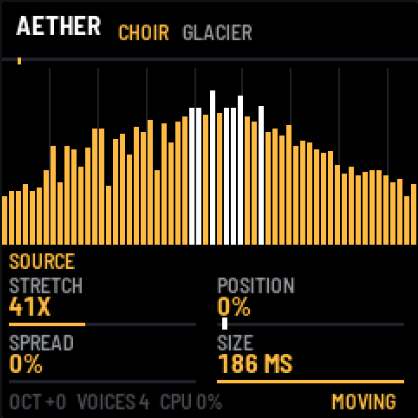

- **Góra:** rodzaj źródła (biały), wybrany sample albo generator (pomarańczowy) i preset (szary), z gwiazdką, gdy coś w nim zmieniłeś. Po prawej HOLD i FREEZE, gdy są włączone. Po każdym
  ruchu gałki przez chwilę widać tu jej nazwę i wartość.

- **Środek:** zależy od strony. Zwykle to widmo ostatniej ramki, od 40 Hz do 16 kHz, z liniami co oktawę. Przy
  samplu nad widmem jest pasek skanu: szary znacznik pokazuje POSITION, jasny miejsce, które gra teraz. Przy HARM
  widać harmoniczne, na stronach LFO i MOD ENV ich przebieg, a na stronie MATRIX listę ośmiu slotów.

- **Nazwa strony** z kropkami po prawej: jedna kropka na każdą stronę, którą ma bieżące źródło, a jasna to ta,
  na której jesteś.

- **Cztery parametry** z wartością i paskiem. **Biały znacznik na pasku** oznacza, że parametr jest modulowany i
  pokazuje, gdzie jest w tej chwili. Sama gałka trzyma swoją wartość.

- **Stopka:** oktawa, liczba brzmiących głosów (do 8), obciążenie procesora i po prawej **MOVING** albo **STATIC**,
  czyli czy coś porusza dźwiękiem w czasie. Gdy działa bezpiecznik przeciążenia, w nagłówku pojawia się napis LOAD.

## Źródła (ALGORITHM i SELECT)

Źródła są w pięciu rodzajach. **ALGORITHM** wybiera rodzaj, a **SELECT** konkretny sample albo generator w jego
obrębie. Rodzaj pamięta, co w nim ostatnio wybrałeś: gdy wrócisz do SAMPLE, zagra ten sam sample. Przy PAD, HARM i VA
SELECT nic nie zmienia, bo każde z nich jest jedno.

| ALGORITHM | SELECT wybiera | Co to jest |
|---|---|---|
| **SAMPLE** | CHOIR … TAPE, USER | nagrania: 16 wbudowanych sampli i sample wgrany z komputera (USER pojawia się dopiero po wgraniu) |
| **LIVE** | VOX, AIR, BOW, BELL | generatory grające na żywo: głosy, wiatr, smyczki, dzwony; nie zajmują pamięci na sample i same powoli się zmieniają |
| **PAD** | – | gotowe chmury harmoniczne (PADsynth): każda harmoniczna to rozmyte pasmo |
| **HARM** | – | generator harmonicznych: liczba, nachylenie, uwypuklenie, 4 obwiednie na wybrane harmoniczne |
| **VA** | – | oscylator wirtualnie analogowy z filtrem, rozmywany na żywo |

Nagłówek pokazuje rodzaj (biały), wybrany sample albo generator (pomarańczowy) i preset (szary), np. „SAMPLE CHOIR
GLACIER”.

Sample: chór, szkło, struny, wiatr, fortepian, wiolonczela, flet, organy, kalimba, sekcja dęta, tanpura, deszcz, ptaki,
szept, gamelan, pianino z taśmy.

Przy samplach klawisz C4 gra oryginalną wysokość, a inne klawisze przesuwają całe widmo.

## Strony i gałki

Każda strona to cztery parametry pod KNOB 1–4. Strona SOURCE zależy od źródła. TONE i HARM ENV A–D są tylko
przy HARM.

### SOURCE: sample (CHOIR … TAPE, USER)


| Gałka | Parametr | Zakres | Co robi |
|---|---|---|---|
| 1 | **STRETCH** | 1x … 8000x, INF | ile razy wolniej skanowany jest sample; INF zatrzymuje skan w miejscu |
| 2 | **POSITION** | 0–100 % | skąd zaczyna się skan (i dokąd wraca po końcu); przy STRETCH INF to „przewijanie” |
| 3 | **SPREAD** | 0–100 % | rozmycie widma: tony rozlewają się w pasma szumu |
| 4 | **SIZE** | 23, 46, 93, 186 ms | długość okna: krótkie jest ziarniste i szybciej reaguje, długie jest gładkie |

### SOURCE: PAD

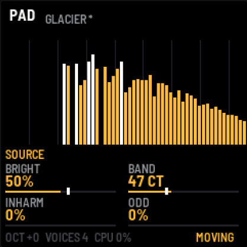

| Gałka | Parametr | Zakres | Co robi |
|---|---|---|---|
| 1 | **BRIGHT** | 0–100 % | jasność: jak wolno słabną wyższe harmoniczne |
| 2 | **BAND** | 1–300 centów | szerokość każdej harmonicznej: wąsko to organy, szeroko to chór |
| 3 | **INHARM** | 0–100 % | rozjeżdżanie harmonicznych w górę, jak w dzwonie lub sztywnej strunie |
| 4 | **ODD** | 0–100 % | wycina parzyste harmoniczne (brzmienie „puste”, klarnetowe) |

### SOURCE: LIVE VOX, LIVE AIR, LIVE BOW, LIVE BELL

To nie są nagrania, tylko małe programy, które przez cały czas grają C4 i podają dźwięk silnikowi, tak jak VA.
To pomysł z demosceny i intr 64k: zamiast danych trzymamy przepis. Każde z tych źródeł zajmuje kilkaset bajtów
kodu, nie ma długości ani pętli i samo z siebie powoli się zmienia.

| Źródło | Co gra |
|---|---|
| **LIVE VOX** | kilka lekko rozstrojonych głosów przez cztery formanty, które powoli przechodzą od samogłoski do samogłoski |
| **LIVE AIR** | wiatr: szum przez rezonanse na harmonicznych nuty, każdy z własnymi podmuchami |
| **LIVE BOW** | smyczki: struny (Karplus-Strong) podtrzymywane szumem „smyczka”, którego nacisk się zmienia |
| **LIVE BELL** | pole dzwonów: rezonatory modalne uderzane w przypadkowych chwilach |

Wszystkie mają te same cztery gałki, które przy każdym znaczą coś trochę innego:

| Gałka | Parametr | VOX | AIR | BOW | BELL |
|---|---|---|---|---|---|
| 1 | **TONE** | oddech i jasność | rejestr rezonansów | tłumienie strun (ciemno ↔ jasno) | jak długo dzwonią wyższe mody |
| 2 | **MOVE** | jak szybko zmieniają się samogłoski | podmuchy | zmiany nacisku smyczka | zmienność uderzeń |
| 3 | **CHARACTER** | głosy niskie ↔ wysokie | szum ↔ gwizd | gładko ↔ szorstko | harmonicznie ↔ dzwonowo |
| 4 | **DENSITY** | 1–6 głosów | 1–8 rezonansów | 1–4 struny | ile uderzeń na sekundę |

MOVE = 0 zatrzymuje wewnętrzny ruch źródła. W matrycy są cele LIVE TONE, LIVE MOVE, LIVE CHAR i LIVE DENSITY, a DRIFT
przy tych źródłach porusza TONE, CHARACTER i TILT. Koszt: kilka procent procesora (szacunek na podstawie pomiaru na
komputerze).

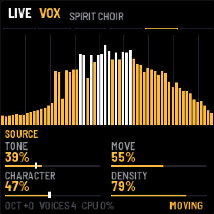

### SOURCE: VA

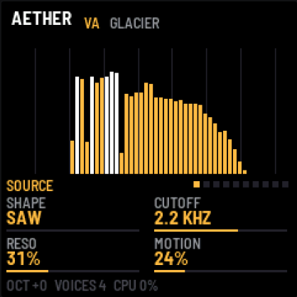

| Gałka | Parametr | Zakres | Co robi |
|---|---|---|---|
| 1 | **SHAPE** | SAW → SQUARE → PULSE | kształt fali: piła, kwadrat, coraz węższy prostokąt |
| 2 | **CUTOFF** | 60 Hz – 18 kHz | odcięcie filtra (24 dB/okt), takie samo dla każdego klawisza |
| 3 | **RESO** | 0–100 % | rezonans filtra: wyraźny szczyt przy odcięciu |
| 4 | **MOTION** | 0–100 % | wolne LFO z dryfem na odcięciu, chmura „oddycha” |

### SOURCE i TONE: HARM

HARM buduje dźwięk z harmonicznych, a na ekranie widzisz ich poziomy jako słupki H1–H32 (skala 48 dB).

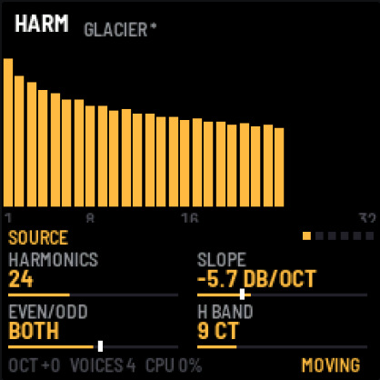

| Gałka | Parametr | Zakres | Co robi |
|---|---|---|---|
| 1 | **HARMONICS** | 1–64 | ile harmonicznych |
| 2 | **SLOPE** | 0 … −18 dB/okt | jak szybko słabną wyższe: 0 to wszystkie równe (jasno), −18 to prawie sama podstawa |
| 3 | **EVEN/ODD** | EVEN 100 % … BOTH … ODD 100 % | w stronę ODD wycisza parzyste, w stronę EVEN nieparzyste (podstawa zostaje) |
| 4 | **H BAND** | 1–150 centów | szerokość każdej harmonicznej: wąsko to czysty ton, szeroko to chór |

Drugie naciśnięcie EDIT otwiera **TONE**, a kolejne obwiednie harmonicznych HARM ENV A–D. TONE to uwypuklenie lub wycięcie wokół wybranej harmonicznej oraz reakcja na
dynamikę.

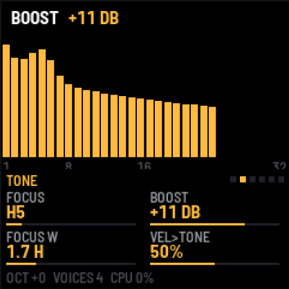

| Gałka | Parametr | Zakres | Co robi |
|---|---|---|---|
| 1 | **FOCUS** | H1–H32 | harmoniczna, wokół której działa BOOST |
| 2 | **BOOST** | −24 … +24 dB | uwypuklenie (+) albo wycięcie (−) wokół FOCUS, jak formant |
| 3 | **FOCUS W** | 0,4–6 harmonicznych | szerokość uwypuklenia: wąsko to jedna harmoniczna, szeroko to grupa |
| 4 | **VEL>TONE** | 0–100 % | cichsze uderzenie daje ciemniejszą barwę: tyle, ile ustawisz |

### HARM ENV A–D: obwiednie harmonicznych (EDIT, przy HARM)

Cztery obwiednie, z których każda steruje wybranymi harmonicznymi. Biegną od początku każdej nuty: narastają
przez ATTACK do pełnej głośności, opadają przez DECAY do poziomu SUSTAIN i tam zostają. Harmoniczne, których
żadna obwiednia nie dotyczy, grają cały czas. Gdy kilka obwiedni trafia w tę samą harmoniczną, ich działanie się
mnoży.

Na stronie obwiedni harmoniczne, którymi steruje, świecą na biało, a w prawym górnym rogu widać jej kształt.
Harmoniczne innych obwiedni są przygaszone na pomarańczowo.

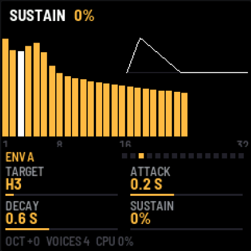 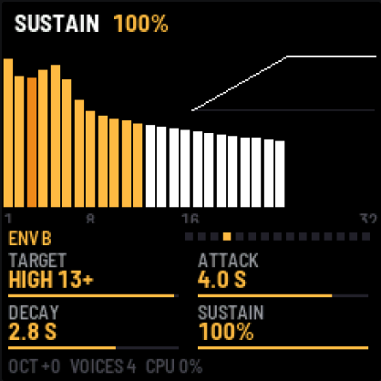

| Gałka | Parametr | Zakres | Co robi |
|---|---|---|---|
| 1 | **TARGET** | OFF, H1–H32, ODD, EVEN, LOW 1-4, MID 5-12, HIGH 13+, ALL | którymi harmonicznymi steruje |
| 2 | **ATTACK** | 10 ms – 20 s | czas narastania |
| 3 | **DECAY** | 50 ms – 30 s | czas opadania do SUSTAIN |
| 4 | **SUSTAIN** | 0–100 % | poziom, na którym zostaje |

Przykłady:

- **ENV A = H3, ATTACK 0,2 s, DECAY 0,6 s, SUSTAIN 0 %** (lewy zrzut): trzecia harmoniczna błyska na początku nuty i znika.
- **ENV B = HIGH 13+, ATTACK 4 s, SUSTAIN 100 %** (prawy zrzut): wysokie harmoniczne wchodzą powoli i barwa się otwiera.
- **TARGET = H1, SUSTAIN 30 %**: podstawa cichnie po ataku, zostaje „powietrze”.

Wyciszenie całej nuty po puszczeniu klawisza ustawiasz osobno: RELEASE na stronie AMP.

### AMP (ENV)

Pierwsza strona pod ENV: obwiednia głośności całej nuty i wyjście.

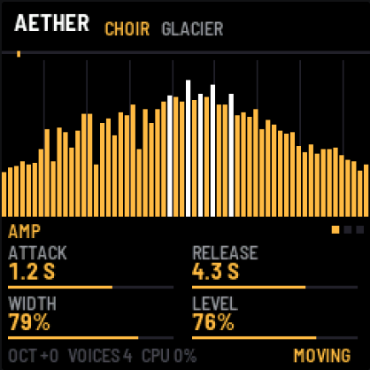

| Gałka | Parametr | Zakres | Co robi |
|---|---|---|---|
| 1 | **ATTACK** | 10 ms – 20 s | narastanie nuty |
| 2 | **RELEASE** | 50 ms – 30 s | wybrzmiewanie po puszczeniu klawisza |
| 3 | **WIDTH** | 0–100 % | szerokość stereo: 0 to mono, 100 to dwa niezależne kanały |
| 4 | **LEVEL** | 0–100 % | głośność silnika (zapas przed miękkim ogranicznikiem) |

### Modulacja: LFO 1–3, MOD ENV 1–2 i MATRIX

Modulacja składa się z dwóch części. **Modulatory** (trzy LFO i dwie obwiednie) tylko się poruszają i same niczego
nie zmieniają. **Matryca** (MATRIX, ostatnia strona pod LFO) ma osiem slotów i każdy łączy jedno źródło z jednym parametrem z
wybraną siłą. Jedno LFO może więc poruszać kilkoma parametrami naraz, każdym z inną siłą i w inną stronę. Jeden
parametr może też słuchać kilku źródeł, a ich działanie się sumuje.

Modulacja dodaje się do ustawienia gałki: gałka wyznacza środek, a modulacja porusza wokół niego. AMOUNT ±100 %
oznacza ruch o cały zakres parametru, a ujemny AMOUNT odwraca kierunek.

#### Szybko: przytrzymaj LFO albo ENV i kręć gałką

Nie musisz wchodzić do matrycy. Na dowolnej stronie przytrzymaj **LFO** i kręć gałką parametru, który ma się ruszać.
Nagłówek pokazuje, co powstało, np. „LFO 1 > CUTOFF +19%”. Kręcenie w prawo to dodatnia siła, w lewo ujemna, a
powrót do 0 % zwalnia slot. **ENV** przytrzymany działa tak samo, tylko z obwiednią MOD ENV. Użyte zostanie LFO
(albo MOD ENV), które oglądałeś ostatnio, a na początku LFO 1 i MOD ENV 1. Wszystko ląduje w matrycy, gdzie możesz to
potem poprawić.

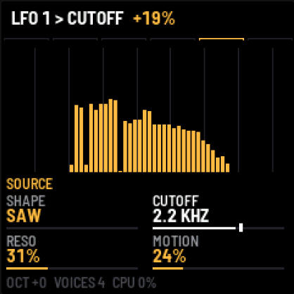

Jeśli parametru nie da się modulować (np. SIZE albo MOTION), nagłówek powie „NO MODULATION”. Gdy wszystkie 8 slotów
jest zajętych, powie „MATRIX FULL”.

#### LFO 1, LFO 2, LFO 3 (LFO)

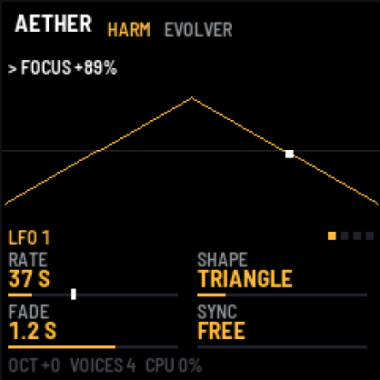

| Gałka | Parametr | Zakres | Co robi |
|---|---|---|---|
| 1 | **RATE** | 0,01–10 Hz | tempo; poniżej 1 Hz ekran pokazuje okres w sekundach (np. 37 S) |
| 2 | **SHAPE** | SINE, TRIANGLE, SAW UP, SAW DOWN, SQUARE, RANDOM, DRIFT | kształt; RANDOM skacze co cykl, DRIFT płynie do losowych punktów |
| 3 | **FADE** | OFF, 10 ms – 20 s | po każdej nowej nucie LFO narasta od zera przez ten czas |
| 4 | **SYNC** | FREE, KEY | KEY: każda nowa nuta zaczyna LFO od początku cyklu |

Na ekranie widać przebieg z kropką w bieżącym miejscu, a nad nim listę celów tego LFO z matrycy.

#### MOD ENV 1 i MOD ENV 2 (ENV, po stronie AMP)

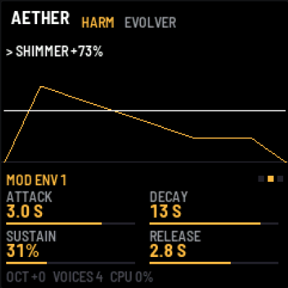

| Gałka | Parametr | Zakres | Co robi |
|---|---|---|---|
| 1 | **ATTACK** | 10 ms – 20 s | narastanie od zera do pełnej wartości |
| 2 | **DECAY** | 50 ms – 30 s | opadanie do SUSTAIN |
| 3 | **SUSTAIN** | 0–100 % | poziom, na którym zostaje, dopóki trzymasz klawisz (albo działa HOLD) |
| 4 | **RELEASE** | 50 ms – 30 s | powrót do zera po puszczeniu wszystkich klawiszy |

Obwiednia startuje od nowa przy każdej nowej nucie (z klawiatury i z MIDI). Jest wspólna dla wszystkich głosów:
porusza parametrem całego dźwięku, a nie pojedynczej nuty. Na ekranie widać jej kształt z kreską na bieżącym poziomie.

#### MATRIX (LFO, po LFO 3)

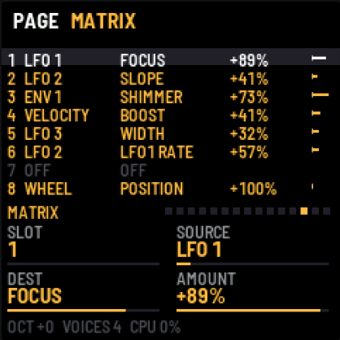

| Gałka | Parametr | Co robi |
|---|---|---|
| 1 | **SLOT** | który z ośmiu slotów edytujesz (podświetlony na liście) |
| 2 | **SOURCE** | źródło modulacji |
| 3 | **DEST** | cel |
| 4 | **AMOUNT** | siła i kierunek, −100 … +100 % |

Lista nad gałkami pokazuje wszystkie osiem slotów: źródło, cel, siłę i pasek z bieżącym wkładem.

**Źródła (SOURCE):**

| Źródło | Wartość | Skąd |
|---|---|---|
| **LFO 1–3** | −1 … +1 | strony LFO |
| **ENV 1–2** | 0 … 1 | strony MOD ENV |
| **VELOCITY** | 0 … 1 | siła uderzenia ostatniej nuty |
| **WHEEL** | 0 … 1 | kółko modulacji, MIDI CC1 |
| **PRESSURE** | 0 … 1 | nacisk na klawisz (FM-1), MIDI aftertouch (kanałowy i polifoniczny) |
| **RANDOM** | −1 … +1 | nowa losowa wartość przy każdej nucie |
| **KEY** | −1 … +1 | wysokość ostatniej nuty: C4 to 0, dwie oktawy w dół lub w górę to −1/+1 |

**Cele (DEST):** STRETCH, POSITION, SPREAD, TILT, SUB, SHIMMER, WIDTH, LEVEL, BRIGHT, BAND, INHARM, ODD, SHAPE,
CUTOFF, RESO, SLOPE, EVEN/ODD, FOCUS, BOOST, H BAND oraz **LFO1 RATE, LFO2 RATE, LFO3 RATE**, czyli tempo innego
LFO (jedno LFO może przyspieszać i zwalniać drugie). Cel działa tylko wtedy, gdy dotyczy bieżącego źródła: na
przykład CUTOFF porusza filtrem VA, a FOCUS działa przy HARM. Do tego **LIVE TONE, LIVE MOVE, LIVE CHAR, LIVE DENSITY**
(źródła LIVE) i **EQ1–EQ3 FREQ, GAIN, WIDTH**, czyli pasma korektora: np. wolne LFO na EQ2 FREQ przy podbitym dzwonie
daje „samogłoskowe” przesuwanie barwy przy każdym źródle.

Fabrycznie slot 8 to **WHEEL → POSITION +100 %**: kółko modulacji przewija sample. Presety mogą to zmienić.

Na stronie parametru, który jest modulowany, biały znacznik na pasku pokazuje jego bieżącą wartość:

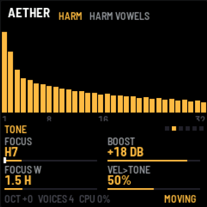

Silnik bierze nowe wartości raz na ramkę, czyli co 11–93 ms zależnie od SIZE. Bardzo szybkie LFO przy dużym SIZE
będzie więc schodkowe. Ta estetyka lubi tempa poniżej 1 Hz.

Kilka pomysłów:

- **LFO 1 → POSITION** (SINE, kilka sekund) przy STRETCH INF przewija sample tam i z powrotem.
- **LFO 1 → FOCUS** (TRIANGLE, wolno) przy BOOST +12 dB daje „samogłoski” przesuwające się po harmonicznych (preset HARM VOWELS).
- **LFO 3 → LFO1 RATE**: samogłoski raz przyspieszają, raz zwalniają.
- **DRIFT → POSITION** sprawia, że skan błądzi po samplu w nieprzewidywalny sposób (preset DRIFT FOG).
- **ENV 1 → SPREAD** z ujemnym AMOUNT: każda nowa nuta zaczyna się czysto i rozmywa.
- **VELOCITY → BOOST** i **PRESSURE → SHIMMER**: mocniejsze granie otwiera barwę, a docisk dokłada oktawę wyżej.
- **RANDOM → POSITION**: każda nuta zaczyna się w innym miejscu sampla.
- **KEY → TILT**: wyższe nuty są jaśniejsze.

### EVOLVE (SEQ): ruch w czasie

Takie faktury żyją dopiero wtedy, gdy powoli się zmieniają: przez minutę, nie przez sekundę. Strona EVOLVE zbiera
wszystko, co porusza dźwiękiem w czasie. Ma cztery gałki, które działają na cały ruch naraz.

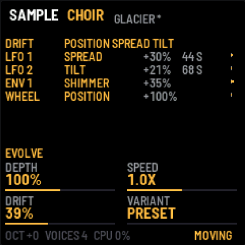

| Gałka | Parametr | Zakres | Co robi |
|---|---|---|---|
| 1 | **DEPTH** | 0–200 % | jak mocno działa cała matryca: 0 % to dźwięk stoi, 100 % jak w ustawieniach, 200 % to podwójnie |
| 2 | **SPEED** | /4X … 4X | tempo wszystkich LFO naraz: /4X to cztery razy wolniej, 4X cztery razy szybciej |
| 3 | **DRIFT** | 0–100 % | wbudowane, bardzo wolne błądzenie (punkt docelowy zmienia się co 20–60 s) trzech parametrów, które najbardziej barwią bieżące źródło |
| 4 | **VARIANT** | PRESET, #1 … #99 | gotowe warianty ruchu: każdy numer to inny zestaw wolnych LFO, obwiedni i tras w matrycy; PRESET przywraca ruch presetu |

DRIFT porusza parametrami zależnie od źródła:

| Źródło | DRIFT porusza |
|---|---|
| sample | POSITION, SPREAD, TILT |
| PAD | BRIGHT, BAND, TILT |
| VA | CUTOFF, SHAPE, TILT |
| HARM | FOCUS, SLOPE, EVEN/ODD |

Nad gałkami jest lista tego, co się teraz rusza: DRIFT i jego parametry, a pod nim każda trasa z matrycy z
siłą, długością cyklu LFO (już z uwzględnieniem SPEED) i paskiem pokazującym jej bieżący wkład.

**VARIANT** to najszybsza droga do ruchomego dźwięku. Kręć KNOB 4 i słuchaj. Ten sam numer przy tym samym źródle
daje zawsze ten sam ruch, więc dobry wariant łatwo odnaleźć. Wariant nadpisuje LFO, MOD ENV 1 i sloty 1–6 matrycy
(sloty 7 i 8 zostają), a VARIANT = PRESET przywraca ruch presetu.

**Podpowiedź.** Jeśli przez 12 s trzymasz dźwięk, w którym nic się nie rusza (stopka pokazuje STATIC), nagłówek raz
podpowie „STATIC SOUND? SEQ: EVOLVE”.

Wszystkie fabryczne presety się ruszają: mają DRIFT, wolne LFO (cykle od kilkunastu sekund do półtorej minuty) i
często obwiednię, która powoli otwiera barwę. To dobry punkt wyjścia: zajrzyj na EVOLVE i do MATRIX, żeby zobaczyć,
jak są zrobione.

### COLOR (FX)

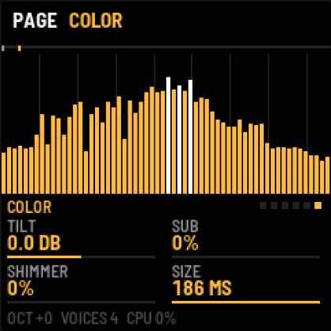

| Gałka | Parametr | Zakres | Co robi |
|---|---|---|---|
| 1 | **TILT** | −6 … +6 dB/okt | przechylenie barwy: ciemniej lub jaśniej, z osią w 500 Hz |
| 2 | **SUB** | 0–100 % | dokłada to samo widmo oktawę niżej |
| 3 | **SHIMMER** | 0–100 % | dokłada to samo widmo oktawę wyżej |
| 4 | **SIZE** | 23–186 ms | to samo co SIZE na stronie sampla, dostępne przy każdym źródle |

### EQ 1, EQ 2, EQ 3 (FX): korektor parametryczny

Trzy pasma korektora działają na samym końcu, na widmie, razem z TILT. Strona EQ pokazuje na tle widma krzywą
całego korektora (biała linia, ±18 dB) i punkty pasm, a pasmo tej strony jest wyróżnione. Korektor jest opcjonalny:
fabrycznie pasma mają 0 dB i nic nie zmieniają (niska półka 150 Hz, dzwon 1 kHz, wysoka półka 5 kHz).

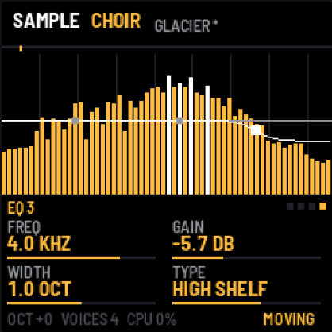

| Gałka | Parametr | Zakres | Co robi |
|---|---|---|---|
| 1 | **FREQ** | 20 Hz – 20 kHz | częstotliwość pasma (przy cięciu: punkt zagięcia) |
| 2 | **GAIN** | −18 … +18 dB | podbicie albo wycięcie (półki i dzwon) |
| 3 | **WIDTH** | 0,25–4 oktawy | szerokość dzwonu, łagodność półki |
| 4 | **TYPE** | OFF, BELL, LOW SHELF, HIGH SHELF, LOW CUT, HIGH CUT | kształt pasma; cięcia mają 12 dB/okt i nie używają GAIN |

FREQ, GAIN i WIDTH każdego pasma są celami w matrycy (EQ1 FREQ … EQ3 WIDTH), więc korektorem można poruszać jak
każdym parametrem. Kilka presetów (np. HARM BLOOM, BELL CLOUD, DAWN) używa EQ 3 jako łagodnej wysokiej półki, żeby
zmiękczyć górę.

### SETUP (GLO)

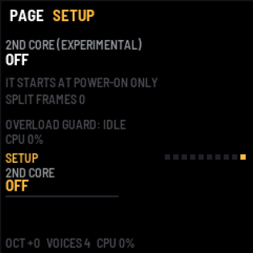

| Gałka | Parametr | Co robi |
|---|---|---|
| 1 | **2ND CORE** | OFF / ON: drugi rdzeń procesora, **eksperymentalnie** |

FM-1 ma dwa rdzenie, ale fabryczne oprogramowania innych autorów używają tylko jednego. Po włączeniu 2ND CORE
drugi rdzeń maluje widma połowy głosów, co daje zapas mocy przy wielu nutach i źródle HARM. Rdzeń da się
uruchomić tylko przy starcie, więc: ustaw ON, naciśnij **SAVE**, wyłącz i włącz FM-1.

Ekran pokazuje stan: OFF, RUNNING, DID NOT START (rdzeń nie odpowiedział), GIVEN UP: ONE CORE (rdzeń się spóźnił
albo źle odczytał zadanie, więc do wyłączenia zasilania gra jeden rdzeń) i BARRED UNTIL POWER-OFF (po takim
błędzie i resecie). We wszystkich tych przypadkach dźwięk gra dalej na jednym rdzeniu. SPLIT FRAMES liczy ramki
podzielone między rdzenie. W emulatorze drugi rdzeń nie działa.

> Ta funkcja nie była jeszcze testowana na prawdziwym FM-1. Według innych autorów na niektórych egzemplarzach
> drugi rdzeń bywa niestabilny pod obciążeniem. Jeśli coś pójdzie nie tak, ustaw OFF i zapisz.

**Bezpiecznik przeciążenia** działa zawsze, także bez drugiego rdzenia. Gdy procesor nie nadąża, AEther po kolei
wyłącza SUB i SHIMMER, a potem zmniejsza liczbę głosów (do dwóch). Po trzech sekundach spokoju wraca krok po
kroku. Stan widać na stronie SETUP (OVERLOAD GUARD) i w nagłówku (LOAD).

## Presety

| Nr | Preset | Źródło | Charakter |
|---|---|---|---|
| 1 | GLACIER | CHOIR | chór rozciągnięty ~40x, punkt startowy |
| 2 | FOG | CHOIR | wolniej, rozmyte, ciemniej, z oktawą niżej |
| 3 | HALO | PAD | jasny pad z oktawą wyżej |
| 4 | ORGAN DUST | PAD | wąskie pasma, bez parzystych: organy |
| 5 | BELL CLOUD | PAD | nieharmoniczne, dzwonowe |
| 6 | ANALOG MIST | VA | piła, ciepły filtr, MOTION |
| 7 | RESO SWEEP | VA | kwadrat, rezonans, wyraźny ruch filtra |
| 8 | HARM BLOOM | HARM | wysokie harmoniczne wchodzą powoli; LFO 1 → TILT, ENV 2 → SLOPE |
| 9 | HARM BELL | HARM | błysk wysokich harmonicznych i H3 na ataku, uwypuklona H5 |
| 10 | HARM VOWELS | HARM | LFO 1 → FOCUS, LFO 2 → BOOST, LFO 3 → tempo LFO 1: wędrujące samogłoski |
| 11 | HARM HOLLOW | HARM | same nieparzyste (klarnetowo), wysokie harmoniczne wchodzą powoli przez ENV A |
| 12 | DRIFT FOG | CHOIR | DRIFT błądzi skanem po samplu (POSITION), drugie LFO kołysze barwą (TILT) |
| 13 | EVOLVER | HARM | sześć slotów matrycy: samogłoski, oddychające nachylenie, SHIMMER z obwiedni, dynamika na BOOST, falująca szerokość |
| 14 | BREATHING GLASS | GLASS | każda nuta zaczyna się czysto i rozmywa (ENV 2), docisk dokłada oktawę wyżej, RANDOM zmienia miejsce startu |
| 15 | GLASS RAIN | GLASS | szkło, z oktawą wyżej |
| 16 | HARP DREAM | STRING | struny, szeroko |
| 17 | WIND TUNNEL | WIND | wiatr, rozmyty, bardzo szeroki |
| 18 | FELT DREAM | PIANO | ciemny fortepian |
| 19 | CELLO SEA | BOWED | wiolonczela, długie narastanie |
| 20 | TANPURA | DRONE | brzęczący bordun, przyciemniony |
| 21 | RAIN ROOM | RAIN | deszcz w pokoju |
| 22 | DAWN | BIRDS | ptaki rozmyte w świt |
| 23 | TAPE MEMORY | TAPE | pianino z taśmy |
| 24 | GRAIN | CHOIR | najkrótsze okno, ziarniste, szybkie |
| 25 | FROZEN | CHOIR | STRETCH INF, mocno rozmyte, zamrożona chwila |
| 26 | DEEP | PAD | ciemny, z mocną oktawą niżej |
| 27 | SPIRIT CHOIR | LIVE VOX | sześć głosów wędrujących między samogłoskami, barwa otwiera się powoli |
| 28 | NORTH WIND | LIVE AIR | gwiżdżący wiatr, rejestr i liczba rezonansów falują |
| 29 | BOWED DRONE | LIVE BOW | cztery struny, smyczek raz gładki, raz szorstki |
| 30 | BELL FIELD | LIVE BELL | dzwony uderzane coraz gęściej i rzadziej |
| 31 | CRYSTAL VOICES | LIVE VOX | wysokie głosy z oktawą wyżej, szybko zmienne samogłoski |

Wybranie presetu zmienia źródło, wszystkie gałki, modulatory i matrycę. SAVE zapamiętuje bieżący stan, także po
zmianach gałek, ale jest tylko jedno miejsce zapisu. Więcej brzmień zachowasz jako presety użytkownika (do 16) z
edytora w przeglądarce: pojawiają się na liście PRESETS po fabrycznych, pod swoimi nazwami. Gdy masz niezapisane zmiany (gwiazdka przy nazwie), pierwszy
ruch PRESETS tylko ostrzega, a dopiero następny zmienia preset.

## Grane

- **HOLD (PLAY):** zagraj akord, puść, a on trwa. Następny akord zastępuje poprzedni. Ponowne PLAY wyłącza HOLD
  i puszcza nuty.

- **FREEZE (REC):** zatrzymuje widmo sampla albo VA w bieżącej chwili. Nuty, obwiednie i AMP grają dalej, a
  skan rusza z miejsca po wyłączeniu FREEZE. Przy PAD i HARM widmo i tak powstaje z gałek, więc FREEZE nic nie zmienia.

- **Opóźnienie:** nuta zaczyna brzmieć w następnej ramce, po ~100–140 ms przy SIZE 186 ms i ~20 ms przy 23 ms.
  To część charakteru, nie błąd.

- **Polifonia:** 8 głosów. Dziewiąta nuta zabiera najcichszy głos. Gdy procesor nie nadąża, bezpiecznik
  przeciążenia czasowo zmniejsza liczbę głosów (patrz SETUP).

## MIDI

Przez USB i gniazdo TRS:

| Wiadomość | Działanie |
|---|---|
| nuty, dowolny kanał | grają (z dynamiką) |
| CC64 | sustain |
| CC1 (kółko modulacji) | źródło WHEEL w matrycy (fabrycznie przewija POSITION) |
| aftertouch (kanałowy, polifoniczny) | źródło PRESSURE w matrycy |
| CC71 | SPREAD |
| CC74 | TILT |
| CC120, CC123 | wszystko off |

Nuty z klawiatury FM-1 wychodzą po USB.

## Edytor w przeglądarce

Na stronie projektu (**editor/**) jest edytor, który łączy się z FM-1 przez USB (Chrome, Edge albo Opera na
komputerze; przeglądarka zapyta o dostęp do MIDI z SysEx):

1. Podłącz FM-1 z AEtherem kablem USB, otwórz edytor, wybierz port FM-1 i kliknij **Connect**.
2. Wszystkie strony (EDIT, ENV, LFO, SEQ, FX, GLO) są widoczne naraz. Każda zmiana na stronie od razu gra w FM-1, a
   każda zmiana pokrętłem na FM-1 pojawia się na stronie.
3. Różowe znaczniki na suwakach pokazują, gdzie modulacja (LFO, obwiednie, EVOLVE) przesuwa parametr w tej chwili.
   Wykres u góry to widmo tego, co gra, z krzywą EQ (ustawioną i zmodulowaną). Matryca pokazuje obok każdego
   slotu bieżącą wartość jego źródła.
4. **Zapisz jako preset użytkownika:** nadaj nazwę (do 12 znaków), wybierz jedno z 16 miejsc i zapisz. Preset
   trafia do pamięci flash FM-1 i pojawia się na liście PRESETS (po 31 fabrycznych). **Zapisz ustawienia** działa
   jak SAVE na FM-1.

**Debug** (na dole edytora): gdy jest otwarty, FM-1 raz na sekundę podaje, ile trwa każde renderowanie dźwięku
(silnik, źródło, modulacja), które etapy silnika zabierają czas, oraz dziennik renderowań, które poszły źle (ponad
80 % czasu, spóźniona ramka, xrun), każde z tym, co wtedy działało. Gdy dźwięk się przerywa, otwórz go, graj aż to
się stanie, naciśnij **Kopiuj raport** i wyślij tekst ze zgłoszeniem.

Dwuklik na suwaku przywraca wartość domyślną. Bez podłączonego FM-1 edytor działa jako podgląd i niczego nie
wysyła.

## Własny sample

```sh
pip install numpy mido python-rtmidi
python3 tools/aether_load.py moj.wav                 # do 23 s, 22 kHz + odbudowa górnego pasma (SBR)
python3 tools/aether_load.py moj.wav --rate 11025    # do 47 s
python3 tools/aether_load.py moj.wav --pcm16         # bez szumu kompresji, do 6 s
```

Po wgraniu źródło przełącza się na USER, a sample zostaje w pamięci po wyłączeniu. Wgrywanie nie działa w
emulatorze.

## Emulator w przeglądarce

Ten sam firmware działa w przeglądarce: zbuduj `./build.sh --web` albo pobierz artefakt `aether-emulator` z CI.
Kliknij **Switch on**. Gałki kręcisz przeciągnięciem w górę/dół, kółkiem albo strzałkami. Akordy myszką robisz
Shift-klikiem (klawisz zostaje wciśnięty).

| Klawisz komputera | FM-1 |
|---|---|
| `Q`–`I`, `A`–`K` | białe klawisze |
| `1`–`0`, `-` | czarne klawisze |
| `Z` / `X` | OCT− / OCT+ |
| `P` | PLAY (HOLD) |
| `O` | REC (FREEZE) |
| `Esc` | HOME |
| `↑` / `↓` na panelu | SELECT (który sample albo generator) |

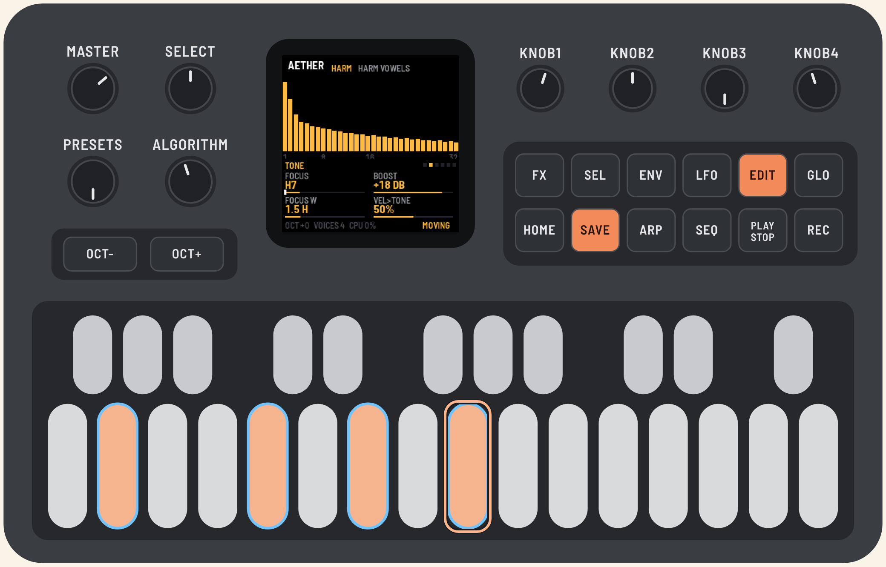
